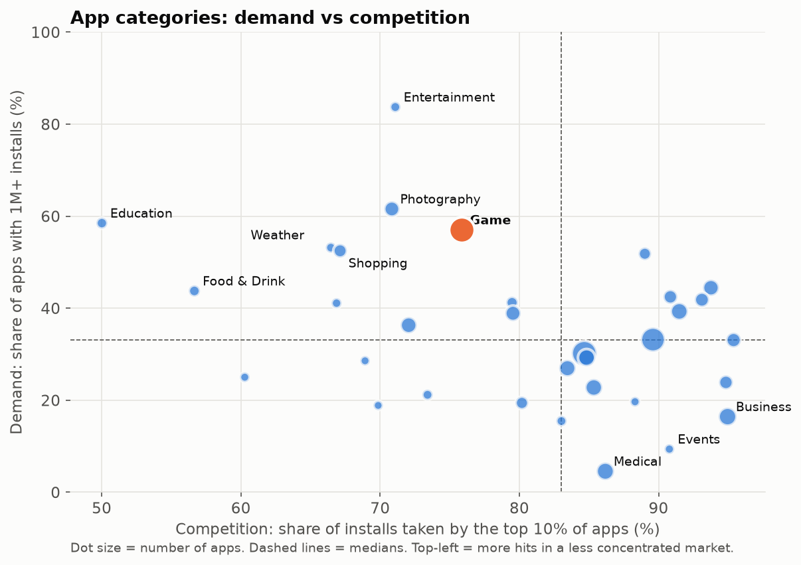
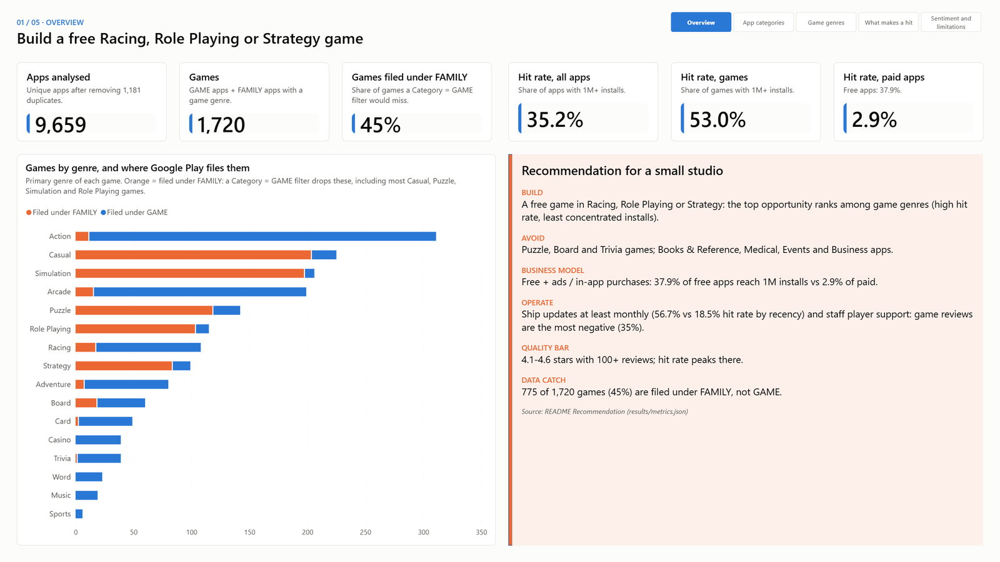
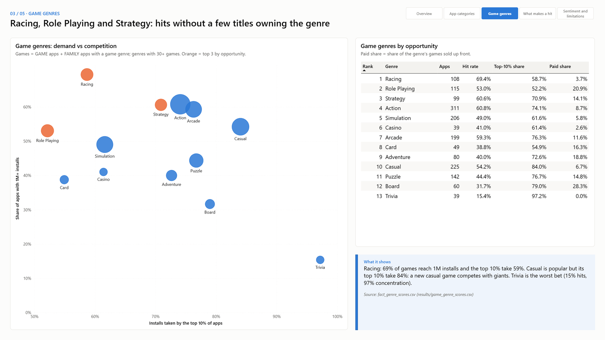
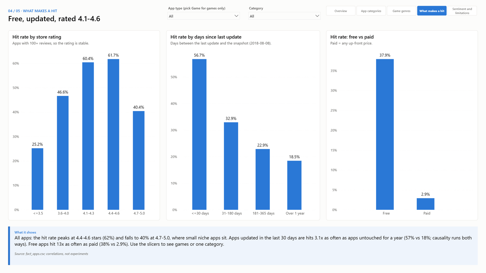
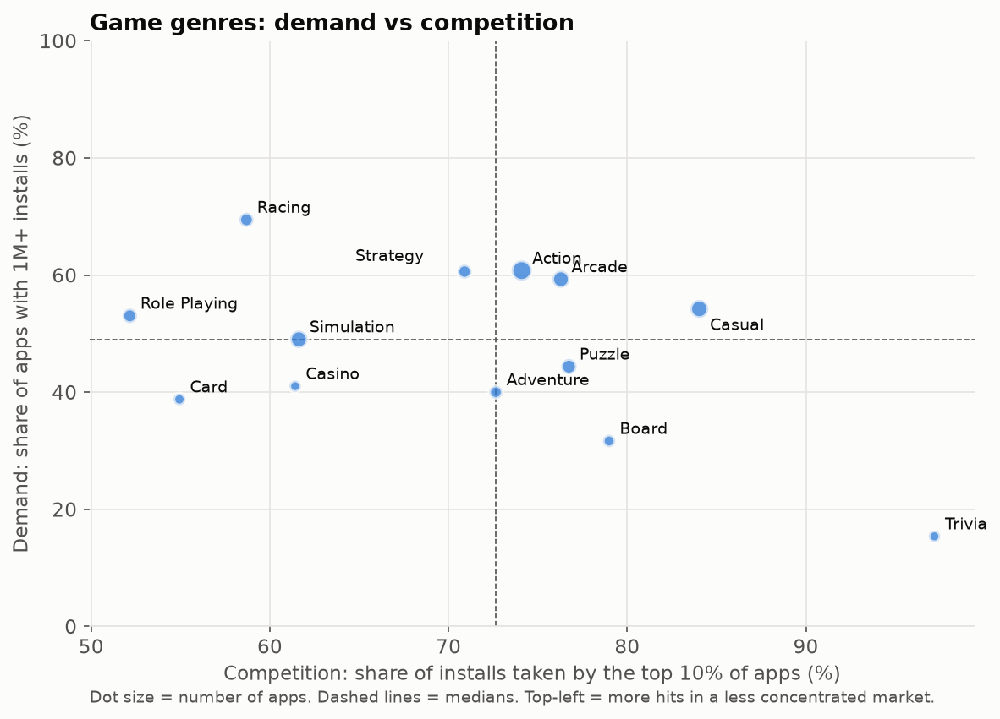
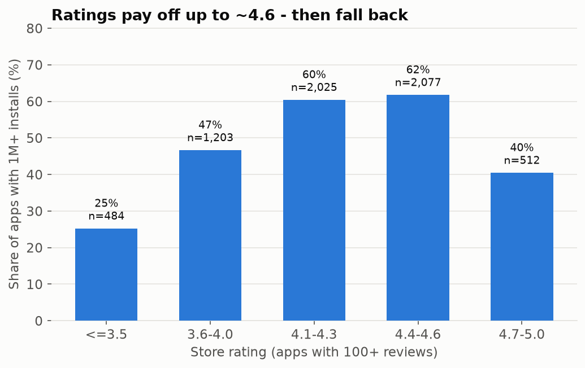
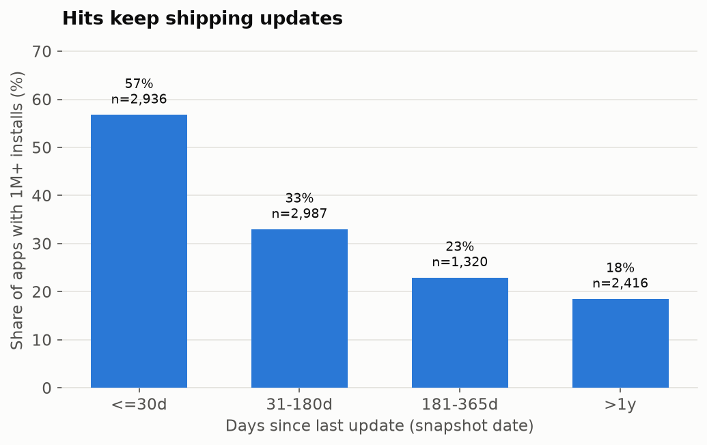
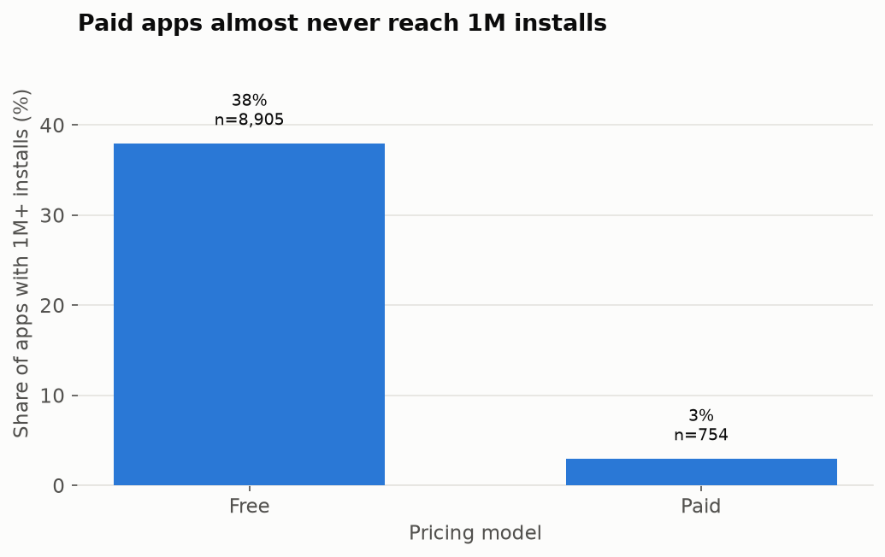
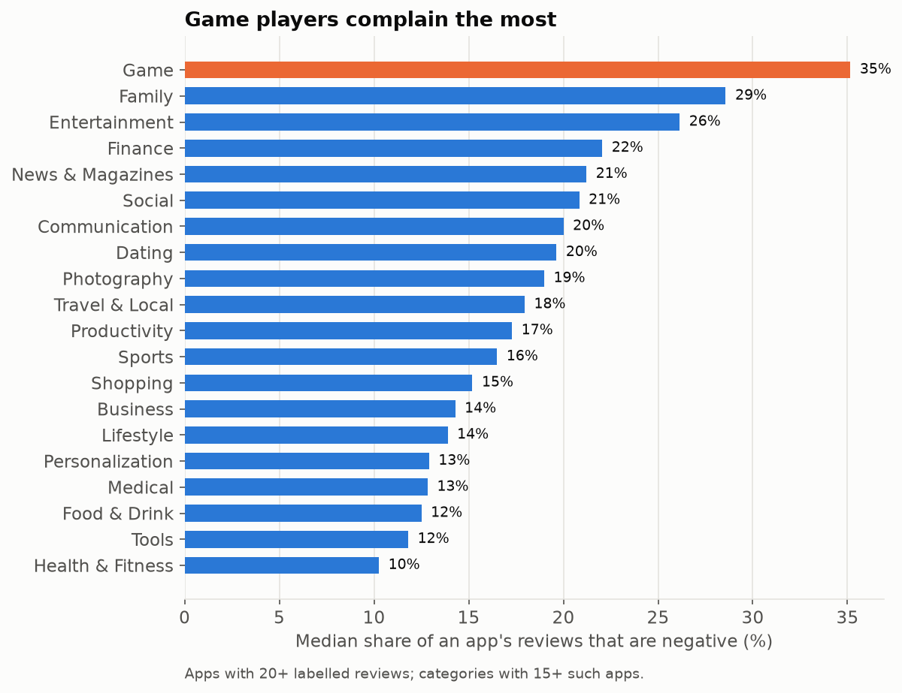

# Google Play market analysis - where should a small studio build next?

A studio with one team and no marketing budget has to pick its next app or game. This repo
answers **which categories and game genres give a new title the best odds**, using the public
Google Play scrape of **9,659 apps** (snapshot 2018-08-08) and
**37,432 labelled user reviews**. Every number below is generated from
[`results/metrics.json`](results/metrics.json) by `python -m gplay` - nothing is typed by hand.

## In 30 seconds



- **Question:** where is demand high but the market not owned by a few giants?
- **Method:** for each category and game genre, *demand* = share of apps reaching 1M+ installs (hit rate),
  *competition* = share of the segment's installs taken by its top 10% of apps. Rank on both.
- **Answer for apps:** Education, Weather, Photography, Food & Drink, Entertainment score best; Books & Reference, Medical, Events, Business score worst.
- **Answer for games:** games are a strong market overall (hit rate 53% vs 35% for all apps).
  Within games, **Racing**, **Role Playing** and **Strategy** combine high hit rates with the
  least concentrated installs; Puzzle, Board, Trivia are dominated by a few titles.
- **How to win once there:** be free (38% of free apps reach 1M+ vs 2.9% of paid),
  keep shipping updates (57% hit rate when updated in the last 30 days vs 18% after a year),
  and budget for player support - game reviews are the most negative of any category (35% negative at the median game).
- **Data catch found on the way:** **775 of 1,720 games (45%) are filed under FAMILY, not GAME.**
  An analysis that filters on `Category == "GAME"` silently drops most Casual, Puzzle, Simulation and Role Playing games.

## Power BI report

A five-page Power BI report ([`powerbi/GooglePlay.pbip`](powerbi/GooglePlay.pbip), PDF:
[`reports/GooglePlay_PowerBI_report.pdf`](reports/GooglePlay_PowerBI_report.pdf)): recommendation first, then the
two market maps, the drivers of a hit (with slicers to switch to games only or one category - hit rates recompute live
in DAX from the 9,659 app rows), and sentiment plus limitations. A reconciliation query
([`powerbi/tools/reconciliation_query.dax`](powerbi/tools/reconciliation_query.dax)) checks the model against
`results/metrics.json` - 23/23 checks pass.



| | |
|---|---|
|  |  |

## Data and cleaning

| Step | Result |
|---|---|
| Source | Kaggle [`lava18/google-play-store-apps`](https://www.kaggle.com/datasets/lava18/google-play-store-apps) (CC BY 3.0, see [`data/raw/license.txt`](data/raw/license.txt)); a copy of the raw files is kept in [`data/raw/`](data/raw/) for reproducibility |
| Raw rows | 10,841 |
| Malformed row (every field shifted one column) | 1 dropped |
| Duplicate listings of the same app | 1,181 dropped, keeping the row with the most reviews (latest scrape) |
| Apps analysed | 9,659 |
| Missing rating | 15% of apps (kept; excluded only from rating analyses) |
| `Installs` | text buckets like "1,000,000+" parsed to their lower bound |
| Games | any `GAME` app, plus `FAMILY` apps whose primary genre is a game genre (1,720 games) |

## Method

1. **Demand - hit rate.** Install counts are buckets, so averages are misleading; the share of apps
   that cross **1M installs** is robust to that, and is what a studio actually wants to know: *what are
   my odds of a hit here?* Wilson 95% intervals show how sure each rate is.
2. **Competition - top-10% install share.** How much of the segment's installs the top tenth of apps
   take. A top-10 count would make small segments look concentrated just for being small; a top-10%
   share doesn't (there is a unit test for this).
3. **Opportunity rank** = percentile of hit rate + percentile of (1 - concentration). Segments under
   50 apps (30 for game genres) are left out as too thin.
4. **Drivers** of a hit within any segment: rating, pricing, update recency, size - with rank
   correlations and Mann-Whitney tests, because installs are ordinal buckets.
5. **Review sentiment** (pre-labelled in the dataset) per app, checked against star ratings before use.

## Results

### App categories (top 10 of 33)

| Rank | Segment | Apps | Hit rate (1M+ installs) | 95% CI | Top-10% install share | Median rating | Paid share |
|---|---|---|---|---|---|---|---|
| 1 | Education | 106 | 58% | 49%-67% | 50% | 4.4 | 2% |
| 2 | Weather | 79 | 53% | 42%-64% | 66% | 4.3 | 10% |
| 3 | Photography | 281 | 62% | 56%-67% | 71% | 4.3 | 7% |
| 4 | Food & Drink | 112 | 44% | 35%-53% | 57% | 4.3 | 2% |
| 5 | Entertainment | 86 | 84% | 75%-90% | 71% | 4.2 | 2% |
| 6 | Shopping | 202 | 52% | 46%-59% | 67% | 4.3 | 1% |
| 7 | Game | 945 | 57% | 54%-60% | 76% | 4.3 | 9% |
| 8 | House & Home | 73 | 41% | 31%-53% | 67% | 4.2 | 0% |
| 9 | Maps & Navigation | 131 | 41% | 33%-50% | 79% | 4.2 | 4% |
| 10 | Parenting | 60 | 25% | 16%-37% | 60% | 4.4 | 3% |

Full table: [`results/category_scores.csv`](results/category_scores.csv).

### Game genres



| Rank | Segment | Apps | Hit rate (1M+ installs) | 95% CI | Top-10% install share | Median rating | Paid share |
|---|---|---|---|---|---|---|---|
| 1 | Racing | 108 | 69% | 60%-77% | 59% | 4.2 | 4% |
| 2 | Role Playing | 115 | 53% | 44%-62% | 52% | 4.3 | 21% |
| 3 | Strategy | 99 | 61% | 51%-70% | 71% | 4.3 | 14% |
| 4 | Action | 311 | 61% | 55%-66% | 74% | 4.3 | 9% |
| 5 | Simulation | 206 | 49% | 42%-56% | 62% | 4.2 | 6% |
| 6 | Casino | 39 | 41% | 27%-57% | 61% | 4.4 | 3% |
| 7 | Arcade | 199 | 59% | 52%-66% | 76% | 4.3 | 12% |
| 8 | Card | 49 | 39% | 26%-53% | 55% | 4.2 | 16% |
| 9 | Adventure | 80 | 40% | 30%-51% | 73% | 4.3 | 19% |
| 10 | Casual | 225 | 54% | 48%-61% | 84% | 4.2 | 7% |
| 11 | Puzzle | 142 | 44% | 36%-53% | 77% | 4.4 | 15% |
| 12 | Board | 60 | 32% | 21%-44% | 79% | 4.3 | 28% |
| 13 | Trivia | 39 | 15% | 7%-30% | 97% | 4.2 | 0% |

**Reading it:** Racing has the best hit rate for how open its install base is. Casual is popular
but 84% of its installs go to the top 10% of titles - a new casual game competes with giants.
Board and Role Playing have the highest paid shares, a sign of players willing to pay up front.

### What separates hits inside a segment



- **Rating:** across all apps the rank correlation between rating and installs is only
  0.03 - rating alone predicts little. Among apps with 100+ reviews the hit rate peaks
  at **4.4-4.6** stars (62%) and falls for 4.7-5.0 (40%): near-perfect scores mostly
  belong to small apps with a loyal niche. Aim for a solid 4.1-4.6, not perfection.
- **Updates:** apps updated in the 30 days before the snapshot are hits 3.1x as often as
  apps untouched for a year. Causality runs both ways (successful apps can afford updates), but an
  unmaintained app does not stay a hit.



- **Price:** paid apps reach 1M installs 13x less often (median 1,000 vs
  100,000 installs; Mann-Whitney p < 0.001), and their median rating is barely higher
  (4.4 vs 4.3). Median paid price is $2.99; 79% cost under $5.



- **Size:** larger apps install more (Spearman 0.31) - a proxy for production value, not a lever.

### What players complain about



The sentiment labels track star ratings (Spearman -0.23 between an app's negative-review share and its
rating, across 677 apps with 20+ labelled reviews), so they are usable. Game reviews are the most negative
(35% at the median game) - far above Health & Fitness (10%). Game players are
engaged enough to complain: support, balancing and bug-fix cadence matter more in games than anywhere else.

## Recommendation for a small studio

| Decision | Choice | Evidence |
|---|---|---|
| **What to build** | A free game in **Racing**, **Role Playing** or **Strategy** | Top opportunity ranks among game genres: high hit rate, least concentrated installs |
| **What to avoid** | Puzzle, Board, Trivia games; Books & Reference, Medical, Events, Business apps | Lowest hit rates and/or most concentrated installs |
| **Business model** | Free + ads / in-app purchases | Free hit rate 38% vs paid 2.9% |
| **Operating plan** | Ship updates at least monthly; staff player support from day one | 57% vs 18% hit rate by update recency; games have the most negative reviews |
| **Quality bar** | 4.1-4.6 stars with 100+ reviews | Hit rate peaks in that band |

## Limitations

- **2018 snapshot.** The specific winners will have moved; the *method* (hit rate vs concentration,
  with a clean game definition) is what transfers to a current data pull.
- **The scrape is not the whole store.** It over-represents visible, popular apps (median 100,000 installs),
  so absolute hit rates are inflated. Use them to *compare* segments, not as real odds.
- **Installs are lower bounds of buckets**, and there is **no revenue column** - "hit" means installs,
  not money. A studio would add revenue estimates from a market-intelligence tool before committing.
- **Correlation only** for the drivers: no experiment, and successful apps can afford more updates.

## Reproduce

```powershell
pip install -r requirements.txt
pip install -e .
# data/raw/ is in the repo; to fetch a fresh copy instead:
#   kaggle datasets download -d lava18/google-play-store-apps -p data/raw --unzip
python -m gplay       # writes results/, figures/, README.md
pytest -q
# Power BI (optional)
python -m gplay.powerbi_export   # writes powerbi/data/*.csv and the reconciliation query
python powerbi/tools/build_model.py      # TMDL model (only needed after changing tables/measures)
node powerbi/tools/build_report.js       # PBIR pages from the approved spec in _brief/report-spec.md
# open powerbi/GooglePlay.pbip in Power BI Desktop, set the CsvFolder parameter to this repo's powerbi/data folder (with a trailing backslash), then Refresh
```

## Repo layout

```
src/gplay/analysis.py   cleaning, game definition, segment scoring, drivers, sentiment -> results/
src/gplay/figures.py    the charts in figures/
src/gplay/report.py     renders this README from results/metrics.json
tests/                  unit tests on parsing, scoring and the data contract
src/gplay/powerbi_export.py  CSV tables + reconciliation query for the Power BI model
powerbi/                GooglePlay.pbip: TMDL model, PBIR report, generators (tools/)
_brief/report-spec.md   approved page-by-page spec the report is generated from
```
